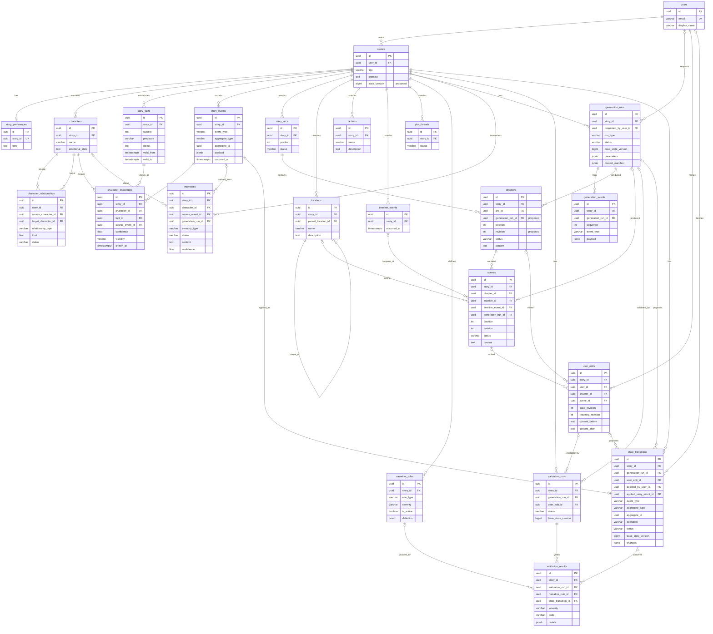

# Modelo de dados PostgreSQL — estado inicial e proposta de evolução

> Nome do projeto no repositório: **Mythra** (a especificação deste trabalho o chama de "Narrative Engine"; os dois nomes designam o mesmo produto e este documento usa o nome do repositório).

## 1. Escopo e princípios

**Escopo.** Este documento (a) descreve o modelo relacional **já implementado** (migration `0001_initial`, commit `bc560a9`, Fases 01 e 02) e (b) especifica as tabelas que foram acrescentadas pelas migrations `0002`–`0009`. A seção 14 registra o que foi efetivamente implementado e verificado, e os desvios em relação à proposta original; as seções 2–13 mantêm o desenho original como referência arquitetural. A seção 3 descreve o estado **antes** das migrations `0002`+.

**Princípios (herdados das decisões da Fase 01/02 e mantidos).**

1. **Estado atual em tabelas relacionais normalizadas.** Não há documento JSON com a história inteira.
2. **Histórico append-only separado** (`story_events`), sem Event Sourcing completo: o estado nunca é reconstruído a partir do log.
3. **A LLM nunca é autoridade.** Geração só escreve rascunhos e *propostas*; o estado canônico muda somente por transição aprovada, aplicada por um caso de uso transacional.
4. **Isolamento por história.** Toda linha pertence a uma história (`story_id`); referências entre linhas de entidades diferentes usam FK composta `(story_id, id)`, de modo que cruzar histórias é impossível no próprio banco. O proprietário é derivado por `stories.user_id`; `user_id` não é duplicado nas tabelas filhas.
5. **Constraints no banco, não só na aplicação**, mas sem impedir mudanças narrativas legítimas (ex.: posições reordenáveis, status livres onde não há vocabulário definido).
6. **Migrations apenas para frente.** `0001_initial` não é reescrita; toda mudança é uma nova revisão Alembic.
7. **Criar tabelas quando a funcionalidade que as usa chegar** (ver seção 13), não todas de uma vez.

**Convenções existentes (mantidas):** UUID como PK (`uuid4` gerado na aplicação), `timestamptz` em UTC, `created_at`/`updated_at` em tabelas mutáveis (sem `updated_at` em histórico imutável), `varchar` + `CHECK` em vez de tipos `ENUM` do PostgreSQL, nomes explícitos de constraints seguindo `NAMING_CONVENTION` em `infrastructure/db/base.py`.

## 2. Inventário de entidades

Legenda: **IMPL** = existe em `0001_initial`; **NOVA** = proposta; **ADIC** = proposta fora da lista inicial, mas necessária.

| Entidade solicitada | Situação | Responsabilidade |
|---|---|---|
| `users` | IMPL | Proprietário das histórias. |
| `stories` | IMPL (+1 coluna proposta) | Raiz de tenant e de agregação; `state_version` proposto para concorrência. |
| `story_preferences` | IMPL | Preferências 1:1 (hoje só `tone`). |
| `characters` | IMPL | Estado atual das personagens. |
| `character_relationships` | IMPL | Relação direcionada atual (`trust`, `status`). |
| `character_knowledge` | IMPL | Quem conhece/suspeita de qual fato, com `confidence`. |
| `locations` | NOVA | Lugares, com hierarquia opcional. |
| `factions` | NOVA | Grupos/organizações da história. |
| `story_arcs` | IMPL | Arcos ordenados. |
| `chapters` | IMPL (+colunas propostas) | Capítulos ordenados dentro de um arco. |
| `scenes` | NOVA | Cenas ordenadas dentro de um capítulo; unidade editável de texto. |
| `plot_threads` | IMPL | Linhas narrativas (`open`/`resolved`/`abandoned`). |
| `timeline_events` | IMPL | Eventos *dentro* do mundo ficcional, ordenados por `occurred_at`. |
| `memories` | NOVA | Memória semântica (interpretações/resumos), **nunca** canônica por si só. |
| `narrative_rules` | NOVA | Regras do mundo/continuidade consumidas pela validação. |
| `generation_runs` | NOVA | Uma execução de geração e a versão de estado em que se baseou. |
| `generation_events` | NOVA | Log append-only de passos de uma execução. |
| `validation_runs` | NOVA | Uma execução de validação sobre um rascunho ou edição. |
| `validation_results` | NOVA | Achados individuais de uma validação. |
| `user_edits` | NOVA | Auditoria imutável de edições de texto do usuário. |
| `story_events` | IMPL | Histórico append-only de mudanças de estado e acontecimentos. |
| `story_facts` | IMPL (**ADIC** em relação à lista) | Fato canônico `subject/predicate/object`, independente de quem o conhece. Já existe; é pré-requisito de `character_knowledge`. |
| `state_transitions` | **ADIC (essencial)** | Proposta de mudança de estado canônico (staging) entre rascunho e estado. Ver 3.2/9. |

**Desvios em relação à lista pedida:**

- **Adicionadas:** `story_facts` (já implementada) e `state_transitions` (nova). Sem esta última não existe lugar para um *rascunho de mudança de estado* antes da aprovação, e o requisito "gerar sem modificar estado canônico" ficaria apenas como convenção.
- **Não fundidas nem renomeadas:** `story_events` (estado/narrativa) e `generation_events` (telemetria de execução) permanecem separadas para que passos técnicos de geração não poluam o histórico narrativo.
- **Candidatas fora do escopo inicial** (não propostas em detalhe, ver seção 12): `faction_memberships` (personagem↔facção), `scene_participants` (personagem↔cena), `characters.current_location_id`, `memory_embeddings` (pgvector), `chapter_versions`.

## 3. Estado implementado (verificado no código)

Fontes: `infrastructure/db/models/narrative.py` e `migrations/versions/0001_initial_narrative_state.py`.

### 3.1 Tabelas existentes (resumo)

Todas têm `id uuid PK`, `created_at timestamptz` e (exceto `story_events`) `updated_at timestamptz`.

| Tabela | Colunas de domínio | FKs / referential actions | Constraints e índices |
|---|---|---|---|
| `users` | `email varchar(320)`, `display_name varchar(200)` | — | `uq_users_email` |
| `stories` | `user_id`, `title varchar(300)`, `premise text` | `user_id → users` **RESTRICT** | `ix_stories_user_id` |
| `story_preferences` | `story_id`, `tone text` | `story_id → stories` CASCADE | `uq_story_preferences_story_id` (1:1) |
| `characters` | `story_id`, `name varchar(200)`, `description`, `age int`, `personality`, `goals`, `fears`, `beliefs`, `emotional_state` (texto, nulos) | `story_id → stories` CASCADE | `uq (story_id,id)`, `ix (story_id)` |
| `character_relationships` | `story_id`, `source_character_id`, `target_character_id`, `relationship_type varchar(100)`, `trust float`, `status varchar(100)` | FKs compostas `(story_id, source/target) → characters(story_id,id)` CASCADE; `story_id → stories` CASCADE | `uq (story_id,source,target)`; `CHECK source <> target`; `CHECK trust ∈ [-1,1]`; `ix (story_id)` |
| `story_facts` | `story_id`, `subject text`, `predicate varchar(200)`, `object text`, `valid_from`, `valid_to` (nulo), `source text` | `story_id → stories` CASCADE | `uq (story_id,id)`, `ix (story_id)` |
| `character_knowledge` | `story_id`, `character_id`, `fact_id`, `known_at`, `confidence float`, `visibility varchar(100)`, `source_event_id` (NOT NULL) | compostas → `characters`, `story_facts` CASCADE; `(story_id, source_event_id) → story_events` **RESTRICT** | `uq (character_id,fact_id)`; `CHECK confidence ∈ [0,1]`; `ix (character_id)`, `ix (fact_id)` |
| `story_arcs` | `story_id`, `title`, `description`, `position int`, `status varchar(100)` | `story_id → stories` CASCADE | `uq (story_id,id)`, `ix (story_id, position)` (não único) |
| `chapters` | `story_id`, `arc_id`, `title`, `position int`, `summary`, `content`, `status varchar(100)` | `(story_id, arc_id) → story_arcs(story_id,id)` CASCADE | `ix (story_id, arc_id, position)` (não único); **sem** `uq (story_id,id)` |
| `timeline_events` | `story_id`, `title`, `description`, `occurred_at timestamptz` | `story_id → stories` CASCADE | `ix (story_id, occurred_at)`; **sem** `uq (story_id,id)` |
| `plot_threads` | `story_id`, `title`, `description`, `status varchar(20)` | `story_id → stories` CASCADE | `CHECK status IN ('open','resolved','abandoned')`; `ix (story_id)`; **sem** `uq (story_id,id)` |
| `story_events` | `story_id`, `event_type varchar(200)`, `aggregate_type varchar(100)`, `aggregate_id uuid`, `payload jsonb`, `occurred_at` | `story_id → stories` CASCADE | `uq (story_id,id)`, `ix (story_id, occurred_at)`; imutável por ausência de rotas de update/delete |

### 3.2 Como Fase 02 usa o modelo

- **Estado atual** = linhas das tabelas acima. O Story State (`get_story_state`) é um snapshot tipado montado em memória; não há tabela `story_state`.
- **Histórico** = `story_events`. Cada transição efetiva grava exatamente um evento na mesma transação da mudança (`character_state_updated`, `relationship_updated`, `character_knowledge_updated`, `canonical_fact_created`, `canonical_fact_updated`, `timeline_event_updated`, `plot_thread_updated`, `story_arc_updated`, `chapter_updated`). `aggregate_type` ∈ `character`, `relationship`, `character_knowledge`, `story_fact`, `timeline_event`, `plot_thread`, `story_arc`, `chapter`. Payload: `{"changes": {campo: {"before": ..., "after": ...}}}` apenas com campos realmente alterados.
- **Fronteira transacional:** `application/transactions.py`; repositories só fazem `add`/`flush`.

### 3.3 Lacunas e riscos encontrados no modelo atual

Marcados como **verificado no código** ou **análise (não executado)**.

| # | Achado | Tipo | Consequência / proposta |
|---|---|---|---|
| L1 | `chapters`, `timeline_events` e `plot_threads` não têm `UNIQUE (story_id, id)`. | verificado | Nenhuma tabela nova poderia referenciá-los com FK composta same-story. Migration aditiva (trivial, pois `id` já é PK). |
| L2 | `fk_knowledge_event_same_story` usa `ON DELETE RESTRICT`. `RESTRICT` não é adiável e é verificado imediatamente. | executado na implementação | A exclusão em cascata de uma história com conhecimento **funcionou** no PostgreSQL 16 (a ordem das cascatas no `0001` a favorece), então o risco não se manifestou; ainda assim depende da ordem de criação das constraints. A migration `0002` troca a ação para `NO ACTION` (verificada ao fim do comando), tornando-a independente de ordem; excluir um evento referenciado continua sendo rejeitado. |
| L3 | `position` de arcos/capítulos não é único. | verificado | Intencional na Fase 01 (permite reordenar). Proposta: unicidade `DEFERRABLE INITIALLY DEFERRED` (seção 6), condicionada a limpeza de dados. |
| L4 | `character_relationships` só tem índice composto iniciando por `(story_id, source_character_id, …)`. | verificado | Consultas "relações em que a personagem é *alvo*" não usam índice; ver seção 7. |
| L5 | Imutabilidade de `story_events` só existe por ausência de rotas. | verificado | Endurecimento opcional no banco (seção 9). |
| L6 | Ordenação de eventos só por `occurred_at` (empates sem desempate). | verificado | Coluna de sequência proposta como decisão em aberto (seção 12). |
| L7 | `visibility` e `relationship_type` são strings sem vocabulário; "não sabe" é representado pela **ausência** de linha em `character_knowledge`. | verificado | Mantido; vocabulário controlado é decisão em aberto. |
| L8 | `character_knowledge.story_id` não tem FK direta para `stories` (apenas FKs compostas via personagem/fato) e não é indexada isoladamente. | verificado | Integridade preservada pelas compostas; índice `(story_id)` só se a carga por história justificar. |

## 4. Relacionamentos e cardinalidades

Notação: `1` obrigatório, `0..1` opcional, `N` muitos. "(composta)" = FK `(story_id, x_id)` para `(story_id, id)`.

| Relação | Cardinalidade | FK e ação | Observação |
|---|---|---|---|
| `users` → `stories` | 1 : N | `stories.user_id` RESTRICT | Usuário com histórias não é removido. |
| `stories` → `story_preferences` | 1 : 0..1 | `story_id` CASCADE, unique | |
| `stories` → `characters`, `story_arcs`, `timeline_events`, `plot_threads`, `story_facts`, `story_events`, `locations`, `factions`, `memories`, `narrative_rules`, `generation_runs`, `validation_runs`, `user_edits`, `state_transitions` | 1 : N | `story_id` CASCADE | Fonte do isolamento por história. |
| `characters` ↔ `characters` | N : N via `character_relationships` | (composta) × 2, CASCADE | Uma linha por direção; `source <> target`. |
| `characters` ↔ `story_facts` | N : N via `character_knowledge` | (composta) × 2, CASCADE | Ausência de linha = desconhece. |
| `story_events` → `character_knowledge` | 1 : N | (composta) RESTRICT (existente) | Origem do conhecimento. |
| `story_arcs` → `chapters` | 1 : N | (composta) CASCADE | |
| `chapters` → `scenes` | 1 : N | (composta) CASCADE | |
| `locations` → `locations` | 1 : N (hierarquia) | (composta) `parent_location_id` NO ACTION | `CHECK parent <> id`; ciclos impedidos na aplicação. |
| `locations` → `scenes` | 0..1 : N | (composta) NO ACTION | Cena pode não ter local. |
| `timeline_events` → `scenes` | 0..1 : N | (composta) NO ACTION | Vínculo opcional cena↔tempo ficcional. |
| `characters` → `memories` | 0..1 : N | (composta) CASCADE | `NULL` = memória da história. |
| `story_events` → `memories` | 0..1 : N | (composta) NO ACTION | Origem da memória. |
| `generation_runs` → `generation_events` | 1 : N | (composta) CASCADE | `sequence` único por execução. |
| `generation_runs` → `chapters` / `scenes` | 0..1 : N | (composta) NO ACTION | Procedência do rascunho (execução que produziu o conteúdo atual). |
| `generation_runs` → `state_transitions` | 0..1 : N | (composta) NO ACTION | Propostas geradas pela execução. |
| `user_edits` → `state_transitions` | 0..1 : N | (composta) NO ACTION | Uma edição pode propor várias transições. |
| `generation_runs` / `user_edits` → `validation_runs` | exatamente um dos dois : N | (composta), `CHECK num_nonnulls = 1` | O que está sendo validado. |
| `validation_runs` → `validation_results` | 1 : N | (composta) CASCADE | |
| `narrative_rules` → `validation_results` | 0..1 : N | (composta) NO ACTION | Regra violada, quando aplicável. |
| `state_transitions` → `validation_results` | 0..1 : N | (composta) NO ACTION | Achado sobre uma proposta específica. |
| `scenes` / `chapters` → `user_edits` | exatamente um dos dois : N | (composta), `CHECK num_nonnulls = 1` | Alvo da edição. |
| `users` → `user_edits`, `generation_runs`, `state_transitions` (decisor) | 1 : N / 0..1 : N | `user_id` NO ACTION | |
| `state_transitions` → `story_events` | 0..1 : 0..1 | (composta) `applied_story_event_id`, unique parcial | Evento gerado ao aplicar. |

**Decisões relevantes**

- "Um usuário pode ter várias histórias" e "uma história contém X" são 1:N diretos, mas o filho carrega apenas `story_id`; o dono é obtido por join, o que evita dois "donos" divergentes.
- "Edições do usuário podem disparar mudanças de estado" é modelado pelo lado da transição (`state_transitions.user_edit_id`), pois uma edição pode gerar zero ou várias transições; `user_edits` permanece imutável.
- "Execuções de geração produzem capítulos" é modelado como procedência (`chapters.generation_run_id`), não como posse: o capítulo continua existindo se a execução for arquivada.

## 5. Diagrama ER (esquema proposto, inclui o implementado)

Tabelas já implementadas: `users`, `stories`, `story_preferences`, `characters`, `character_relationships`, `story_facts`, `character_knowledge`, `story_arcs`, `chapters`, `timeline_events`, `plot_threads`, `story_events`. Demais são propostas. FKs compostas aparecem como uma linha por coluna `FK`; todas incluem `story_id`.

## 6. Especificação tabela a tabela das entidades novas e alterações

Convenções para todas as tabelas novas: `id uuid PK`; `story_id uuid NOT NULL → stories(id) ON DELETE CASCADE`; `UNIQUE (story_id, id)` sempre que a tabela for alvo de FK composta; `created_at timestamptz NOT NULL` (mais `updated_at` se mutável); status como `varchar` + `CHECK`. FKs compostas com coluna opcional nula **não são verificadas** (`MATCH SIMPLE`), o que é o comportamento desejado para vínculos opcionais. `ON DELETE SET NULL` em FK composta foi evitado porque anularia também `story_id` (NOT NULL); alternativas são `NO ACTION` ou `SET NULL (coluna)` do PostgreSQL 15+.

Campos de domínio das tabelas `locations`, `factions`, `scenes`, `memories`, `narrative_rules`, `generation_*`, `validation_*`, `user_edits` e `state_transitions` **não estão definidos pelo repositório**; os abaixo são **propostas e suposições** (ver seção 12).

### 6.1 Alterações em tabelas existentes (migration aditiva)

| Tabela | Alteração | Motivo |
|---|---|---|
| `chapters`, `timeline_events`, `plot_threads` | `UNIQUE (story_id, id)` | L1: permitir FKs compostas. |
| `stories` | `state_version bigint NOT NULL DEFAULT 0` | Concorrência otimista (seção 10). Incrementada a cada transição canônica aplicada, inclusive os `PATCH` diretos da Fase 02 (nesse caso, no mesmo caso de uso que grava o evento). |
| `chapters` | `revision int NOT NULL DEFAULT 1`; `generation_run_id uuid NULL` (composta, NO ACTION) | Lock otimista de edição; procedência. A FK só pode ser criada depois de `generation_runs`. |
| `story_events` | índice `(story_id, aggregate_type, aggregate_id, occurred_at)` | Auditoria por entidade. |
| `character_relationships` | índice `(story_id, target_character_id)` | L4. |
| `story_arcs`, `chapters` | (opcional) `UNIQUE … DEFERRABLE INITIALLY DEFERRED` em `(story_id, position)` e `(arc_id, position)` | L3; só após verificar dados existentes. |

### 6.2 `locations`

| Coluna | Tipo | Nulo | Observação |
|---|---|---|---|
| `parent_location_id` | uuid | sim | FK composta `(story_id, parent_location_id) → locations(story_id,id)` NO ACTION |
| `name` | varchar(200) | não | |
| `description` | text | sim | |
| `location_type` | varchar(100) | sim | texto livre (suposição; sem vocabulário definido) |
| `created_at`, `updated_at` | timestamptz | não | |

Constraints: `UNIQUE (story_id, id)`; `CHECK (parent_location_id IS NULL OR parent_location_id <> id)`. Não impõe nome único (dois "Mercado" em cidades distintas são legítimos). Exclusão de local referenciado por cena é bloqueada (`NO ACTION`); a política é arquivar, não excluir.

### 6.3 `factions`

Colunas: `name varchar(200) NOT NULL`, `description text NULL`, timestamps. Constraints: `UNIQUE (story_id, id)`; índice único `(story_id, lower(name))` (suposição: nomes de facção são únicos por história). A relação personagem↔facção não está no escopo inicial (candidata `faction_memberships`, seção 12).

### 6.4 `scenes`

| Coluna | Tipo | Nulo | Observação |
|---|---|---|---|
| `chapter_id` | uuid | não | composta → `chapters(story_id,id)` **CASCADE** |
| `position` | int | não | `CHECK position >= 1`; único por capítulo (adiável) |
| `title` | varchar(300) | sim | |
| `summary` | text | sim | |
| `content` | text | sim | texto editável da cena |
| `status` | varchar(100) | não | mesmo vocabulário de `chapters.status` (ainda livre) |
| `revision` | int | não | default 1; lock otimista |
| `location_id` | uuid | sim | composta → `locations` NO ACTION |
| `timeline_event_id` | uuid | sim | composta → `timeline_events` NO ACTION |
| `generation_run_id` | uuid | sim | composta → `generation_runs` NO ACTION |

Constraints: `UNIQUE (story_id, id)`; `UNIQUE (chapter_id, position) DEFERRABLE INITIALLY DEFERRED`. Índice: `(chapter_id, position)` (coberto pelo unique).

### 6.5 `narrative_rules`

Colunas: `rule_type varchar(50) NOT NULL` (ex.: `world`, `continuity`, `style`; vocabulário a definir), `title varchar(300) NOT NULL`, `description text NOT NULL` (regra em linguagem natural), `severity varchar(20) NOT NULL CHECK IN ('info','warning','error')` (efeito de uma violação), `is_active boolean NOT NULL DEFAULT true`, `definition jsonb NULL` (forma verificável por máquina, quando existir), timestamps. `UNIQUE (story_id, id)`. Regras são estado canônico: alterações passam por `state_transitions`/`story_events` (`aggregate_type = 'narrative_rule'`).

### 6.6 `memories` (memória semântica)

| Coluna | Tipo | Nulo | Observação |
|---|---|---|---|
| `character_id` | uuid | sim | composta → `characters` CASCADE; nulo = memória da história |
| `memory_type` | varchar(50) | não | ex.: `summary`, `interpretation`, `observation` (a definir) |
| `content` | text | não | |
| `confidence` | float | sim | `CHECK ∈ [0,1]` |
| `status` | varchar(20) | não | `CHECK IN ('active','superseded','rejected')` |
| `source_event_id` | uuid | sim | composta → `story_events` NO ACTION |
| `generation_run_id` | uuid | sim | composta → `generation_runs` NO ACTION |

**Propositalmente não há FK de `memories` para `story_facts`/`character_knowledge`**: memória não é fato. Não há coluna `is_canonical`. O embedding (pgvector) ficará em tabela separada futura `memory_embeddings (memory_id, model, dimensions, embedding vector)` para suportar vários modelos sem alterar `memories`.

### 6.7 `generation_runs`

| Coluna | Tipo | Nulo | Observação |
|---|---|---|---|
| `requested_by_user_id` | uuid | sim | `→ users` NO ACTION; nulo para execuções do sistema |
| `run_type` | varchar(50) | não | ex.: `chapter`, `scene`, `regeneration` (a definir) |
| `status` | varchar(20) | não | `CHECK IN ('pending','running','succeeded','failed','cancelled')` |
| `base_state_version` | bigint | não | `stories.state_version` lido ao montar o contexto |
| `provider` / `model` | varchar | sim | |
| `parameters` | jsonb | não | default `'{}'`; ver seção 8 |
| `context_manifest` | jsonb | sim | **ids** de fatos/memórias/regras usados, não o texto |
| `usage` | jsonb | sim | tokens/latência (telemetria) |
| `error` | text | sim | |
| `started_at`, `finished_at` | timestamptz | sim | |

Constraints: `UNIQUE (story_id, id)`; `CHECK (finished_at IS NULL OR started_at IS NULL OR finished_at >= started_at)`. Índice `(story_id, created_at DESC)`. Não é removida pela aplicação (histórico).

### 6.8 `generation_events`

Colunas: `generation_run_id` (composta → `generation_runs`, CASCADE), `sequence int NOT NULL`, `event_type varchar(100) NOT NULL` (ex.: `context_assembled`, `model_called`, `output_received`, `error`), `payload jsonb NOT NULL DEFAULT '{}'`, `occurred_at`, `created_at`. `UNIQUE (generation_run_id, sequence)`. Append-only (sem `updated_at`).

### 6.9 `validation_runs`

Colunas: `generation_run_id` e `user_edit_id` (ambas nulas, compostas, NO ACTION), `validator varchar(100) NOT NULL` (ex.: `consistency_engine`, `human`), `status varchar(20) NOT NULL CHECK IN ('pending','running','passed','failed','error')`, `base_state_version bigint NOT NULL`, `started_at`, `finished_at`. Constraints: `CHECK (num_nonnulls(generation_run_id, user_edit_id) = 1)`; `UNIQUE (story_id, id)`. Índices: `(generation_run_id)`, `(user_edit_id)` (parciais `WHERE … IS NOT NULL`).

### 6.10 `validation_results`

Colunas: `validation_run_id` (composta, CASCADE), `narrative_rule_id` (nula, NO ACTION), `state_transition_id` (nula, NO ACTION), `scene_id` (nula, NO ACTION), `severity varchar(20) NOT NULL CHECK IN ('info','warning','error')`, `code varchar(100) NOT NULL`, `message text NOT NULL`, `details jsonb NULL`. Índice `(validation_run_id)`. Imutável (sem `updated_at`).

### 6.11 `user_edits`

Colunas: `user_id uuid NOT NULL → users` NO ACTION, `chapter_id` / `scene_id` (nulas, compostas, NO ACTION), `base_revision int NOT NULL`, `resulting_revision int NOT NULL`, `content_before text NOT NULL`, `content_after text NOT NULL`, `note text NULL`, `created_at`. Constraints: `CHECK (num_nonnulls(chapter_id, scene_id) = 1)`; `CHECK (resulting_revision > base_revision)`; `UNIQUE (story_id, id)`. Imutável. Índices: `(story_id, created_at DESC)`; `(scene_id, resulting_revision)` e `(chapter_id, resulting_revision)` parciais.

### 6.12 `state_transitions` (proposta de mudança canônica)

| Coluna | Tipo | Nulo | Observação |
|---|---|---|---|
| `generation_run_id` / `user_edit_id` | uuid | sim | origem; `CHECK num_nonnulls = 1` |
| `event_type` | varchar(200) | não | tipo de `StoryEvent` que será emitido (vocabulário da Fase 02 + `narrative_rule_*`) |
| `aggregate_type` | varchar(100) | não | mesma convenção de 3.2 |
| `aggregate_id` | uuid | sim | nulo em criações até a aplicação |
| `operation` | varchar(10) | não | `CHECK IN ('create','update')` |
| `changes` | jsonb | não | **mesmo contrato do payload do evento**: `{"changes": {campo: {before, after}}}` |
| `base_state_version` | bigint | não | |
| `status` | varchar(20) | não | `CHECK IN ('proposed','approved','rejected','applied','stale')` |
| `decided_by_user_id` | uuid | sim | `→ users` NO ACTION; nulo se aprovada por política automática |
| `decided_at`, `applied_at` | timestamptz | sim | |
| `applied_story_event_id` | uuid | sim | composta → `story_events` NO ACTION |

Constraints: `CHECK (status <> 'applied' OR (applied_at IS NOT NULL AND applied_story_event_id IS NOT NULL))`; `CHECK (status NOT IN ('approved','rejected','applied') OR decided_at IS NOT NULL)`; índice único parcial `(applied_story_event_id) WHERE applied_story_event_id IS NOT NULL`; `UNIQUE (story_id, id)`. Índice `(story_id, status, created_at)`, com versão parcial `WHERE status = 'proposed'`.

## 7. Relacional versus JSONB

| Campo | JSONB? | Justificativa | Validação | Índice | Pode virar tabela? |
|---|---|---|---|---|---|
| `story_events.payload` (existente) | sim | Forma varia por `event_type`; é registro histórico, não estado | Pydantic/contrato `changes` na aplicação | não | não |
| `state_transitions.changes` | sim | Envelope da proposta; mesma forma do payload do evento; os valores finais vão para colunas relacionais ao aplicar | mesmo contrato do evento, validado antes de gravar e antes de aplicar | não (consultas por `status`/`story_id`) | improvável |
| `generation_runs.parameters` | sim | Configuração específica de provedor/modelo (temperatura, limites), varia e muda | schema por `provider` na aplicação | não | não |
| `generation_runs.context_manifest` | sim | Lista de ids usados em um contexto; formato evolui | lista de UUIDs/tipos validada na aplicação | GIN só se houver consulta "quais execuções usaram o fato X" | sim, se essa consulta se tornar frequente (tabela de junção) |
| `generation_runs.usage` | sim | Métricas variam por provedor | aplicação | não | pode migrar para tabela de telemetria (Fase 06) |
| `generation_events.payload` | sim | Passos heterogêneos | por `event_type` | não | não |
| `narrative_rules.definition` | sim | Forma depende de `rule_type`; opcional | Pydantic por `rule_type` | não | sim, quando houver tipos estáveis de regra verificável |
| `validation_results.details` | sim | Evidência heterogênea (trechos, ids conflitantes) | aplicação | não | não |

**Mantidos como colunas relacionais:** tudo que sofre filtro, join, unicidade ou exige integridade (status, posições, `confidence`, `trust`, `known_at`, ids de vínculo). O estado da história nunca é guardado como documento único.

## 8. Estratégia de índices

PostgreSQL **não** cria índice automático para colunas de FK; toda FK usada em join ou em exclusão em cascata deve começar por `story_id` (ou pelo pai) em algum índice.

| Operação | Índice | Classe |
|---|---|---|
| Carregar história e estrutura | PK de `stories`; `ix_story_arcs (story_id, position)`; `ix_chapters (story_id, arc_id, position)`; `scenes (chapter_id, position)` | essencial (existente + novo) |
| Listar personagens | `ix_characters_story_id` | essencial (existente) |
| Fatos conhecidos de uma personagem | `ix_character_knowledge_character_id` (+ `fact_id`) | essencial (existente) |
| Relações que envolvem personagem | unique `(story_id, source, target)` cobre origem; novo `(story_id, target_character_id)` | essencial (novo) |
| Capítulos/cenas em ordem | índices acima | essencial |
| Threads abertas | `ix_plot_threads_story_id` basta; parcial `(story_id) WHERE status='open'` | adiar até observar volume |
| Timeline por história e tempo | `ix_timeline_events (story_id, occurred_at)` | essencial (existente) |
| Memórias por história/personagem | `memories (story_id, character_id, status, created_at DESC)` | essencial (nova) |
| Histórico de geração | `generation_runs (story_id, created_at DESC)`; `generation_events` via unique `(run, sequence)` | essencial |
| Histórico de validação | `validation_runs (generation_run_id)`, `validation_results (validation_run_id)` | essencial |
| Auditar edições do usuário | `user_edits (story_id, created_at DESC)` + parciais por alvo | essencial |
| Auditar mudanças canônicas | `story_events (story_id, occurred_at)` (existente) + `(story_id, aggregate_type, aggregate_id, occurred_at)` | essencial (novo o segundo) |
| Propostas pendentes | parcial `state_transitions (story_id, created_at) WHERE status='proposed'` | essencial para o fluxo de aprovação |
| GIN em JSONB, `narrative_rules WHERE is_active`, índices de `severity` | — | **só após observar consultas** |

**pgvector (nível arquitetural).** Não é necessário agora. A extensão e `memory_embeddings` entram numa migration própria quando o Memory Engine existir (Fase 04), com índice HNSW/IVFFlat por modelo. Os ids UUID e `story_id` já presentes permitem filtrar por história antes/depois da busca vetorial.

## 9. Estado canônico, histórico, conteúdo, fatos e memórias

| Conceito | Onde vive | Mutabilidade | Quem escreve |
|---|---|---|---|
| Estado canônico atual | `characters`, `character_relationships`, `story_arcs`, `timeline_events`, `plot_threads`, `locations`, `factions`, `narrative_rules`, `stories` | mutável | só casos de uso de transição (Fase 02) |
| Fatos canônicos | `story_facts` | mutável com evento | transição `canonical_fact_*` |
| Conhecimento de personagem | `character_knowledge` (ausência = desconhece) | mutável com evento | transição `character_knowledge_updated` |
| Conteúdo narrativo | `chapters`, `scenes` (`content`, `summary`) | mutável, com `revision` | edição do usuário ou execução de geração |
| Histórico narrativo/estado | `story_events` | append-only | casos de uso, mesma transação da mudança |
| Histórico de execução | `generation_events`, `validation_*`, `user_edits` | append-only | pipeline futuro |
| Propostas | `state_transitions` | muda só o `status` | geração/edição cria; decisão/aplicação atualiza |
| Memória semântica | `memories` | mutável (status) | pipeline futuro; nunca altera canônico |

**`state_transitions` versus `story_events`.** A proposta (`state_transitions`) é o *intent* e tem ciclo de vida; o evento (`story_events`) é o *fato histórico* de que a mudança foi aplicada e é imutável. Ambos usam o mesmo contrato `changes`, o que permite aplicar uma proposta reaproveitando exatamente o caminho de Fase 02.

**Como impedir mudança silenciosa de estado canônico**

1. Geração só escreve em: rascunhos de `chapters`/`scenes` (conteúdo, não estado), `generation_*` e `state_transitions` com `status='proposed'`. Nenhuma tabela canônica é escrita por essa transação.
2. Uma proposta só altera estado ao ser aplicada por caso de uso que: exige `status='approved'`, aplica a mudança, grava o `story_event` e marca a proposta `applied`, tudo numa única transação. O banco garante que `applied` implica `applied_at` e `applied_story_event_id` (único).
3. Achados de validação com severidade `error` bloqueiam a aprovação automática (política na aplicação; quem pode sobrescrever é decisão em aberto).
4. Uma inferência não validada ou uma memória semântica não possuem caminho por FK para tabelas canônicas; para virarem fato precisam gerar uma `state_transition` de `canonical_fact_created`.
5. Todo estado canônico aplicado deixa um `story_event`; ausência de evento para uma mudança é detectável por auditoria.
6. Endurecimento opcional (suposição, não proposto como obrigatório): papel de banco da geração sem `INSERT/UPDATE/DELETE` nas tabelas canônicas, e triggers que rejeitem `UPDATE/DELETE` em `story_events`.

**Edições diretas via API (Fase 02).** Os `PATCH` atuais continuam sendo transições explícitas do usuário, aplicadas imediatamente com `story_event`, sem `state_transitions`. Se o usuário editar texto e a aplicação inferir mudanças canônicas, estas passam por `state_transitions` (origem `user_edit_id`).

## 10. Transações e concorrência

Fluxo lógico e fronteiras transacionais (cada item "T" é **uma** transação; nunca manter transação aberta durante a chamada à LLM):

| Passo | Transação | Atomicidade |
|---|---|---|
| 1–2. Carregar estado e montar contexto | T0, somente leitura | Ler `stories.state_version` junto com os dados. |
| 3. Gerar rascunho | fora do banco | Nada canônico é modificado. |
| 3a. Registrar a execução | T1 | Inserir `generation_runs (status='running', base_state_version)` e confirmar antes de chamar a LLM. |
| 4. Persistir resultado | T2 | Atomicamente: rascunho (`chapters`/`scenes` com `status` de rascunho e `generation_run_id`), `state_transitions` `proposed`, `generation_events`, `generation_runs.status`. |
| 5. Validar | T3 | `validation_runs` + todos os `validation_results` juntos. |
| 6. Aceitar/rejeitar | T4 | Atualizar `status` das propostas (condicional: `UPDATE … WHERE status='proposed'`). |
| 7–8. Aplicar transições e registrar eventos | T5 | `SELECT … FROM stories WHERE id=… FOR UPDATE`; conferir `state_version` e os valores `before`; aplicar mudanças canônicas; um `story_event` por transição efetiva; marcar propostas `applied`; incrementar `state_version`; promover o rascunho. **Tudo ou nada.** |
| 9. Memórias | T6, separada | Falha aqui não desfaz o estado canônico; memórias nunca referenciam fatos por FK. |

**Riscos de concorrência e mitigação**

- *Duas execuções sobre a mesma versão:* a segunda a aplicar encontra `state_version` diferente ou `before` divergente; suas propostas passam a `stale` e exigem nova validação. Regra: o `before` por campo decide a aplicabilidade de uma transição; `state_version` decide se a *validação* ainda vale.
- *Edição do usuário durante a geração:* `UPDATE scenes SET … WHERE id=:id AND revision=:base` (lock otimista); zero linhas ⇒ conflito (409) e nenhuma escrita.
- *Dupla aplicação da mesma proposta:* `UPDATE … WHERE status='approved'` + índice único parcial de `applied_story_event_id`.
- *Deadlock:* ordem de lock fixa (primeiro `stories`, depois entidades); T5 é a única transação que escreve em várias tabelas canônicas.
- *Isolamento:* `READ COMMITTED` (padrão) é suficiente porque a serialização por história é feita com `FOR UPDATE` e `state_version`; `SERIALIZABLE` não é necessário.
- *Ordenação de eventos:* `occurred_at` pode empatar; ver decisão em aberto sobre uma coluna de sequência.

## 11. SQLAlchemy e Alembic

- **Convenção existente mantida:** modelos declarativos 2.x com `Mapped[...]`/`mapped_column`, mixins `IdCreatedMixin` e `TimestampMixin`, `Base` com `NAMING_CONVENTION`, constraints nomeadas explicitamente (`ck_*`, `fk_*`, `uq_*`), `JSONB` de `sqlalchemy.dialects.postgresql`. Hoje todos os modelos estão em `models/narrative.py`; ao adicionar as tabelas, dividir por área (`world.py`, `structure.py`, `generation.py`) é opcional e não altera as migrations.
- **FK composta:** usar `ForeignKeyConstraint([...], [...], name="fk_<tabela>_<alvo>_same_story")` como já feito em `character_knowledge`.
- **CHECK de vocabulário:** `CheckConstraint("status IN (...)", name="ck_<tabela>_status")`; evitar `ENUM` do PostgreSQL por dificultar migrations.
- **Alembic:** cada bloco da seção 13 é uma revisão nova (`0002_…`, `0003_…`) com `down_revision` encadeado; `0001_initial` permanece intacta. Constraints/índices novos em tabelas populadas: `CREATE INDEX CONCURRENTLY` fora de transação quando o volume justificar e, para `CHECK`/FK, `NOT VALID` seguido de `VALIDATE CONSTRAINT`. Usar `server_default` para colunas novas `NOT NULL` (`state_version`, `revision`).
- **Atenção a `migrations/env.py`:** ele sempre usa a URL das settings (`MYTHRA_DATABASE_URL`), não a definida por `set_main_option`; a suíte já isola o banco de teste por variável de ambiente (`tests/integration/conftest.py`).
- **Testes por migration:** `alembic upgrade head`, `alembic check` (sem drift) e testes de integração das constraints (padrão de `tests/integration/test_api_persistence.py`: inserções inválidas devem levantar `IntegrityError`).

## 12. Suposições, trade-offs e decisões em aberto

**Suposições (não suportadas por requisito do repositório)**

- Campos de `locations`, `factions`, `scenes`, `narrative_rules`, `memories` e das tabelas de geração/validação são propostas deste documento.
- Nome único de facção por história; `location_type` e `memory_type` como strings livres.
- Valores de status de `generation_runs`, `validation_runs` e `state_transitions` são propostos.

**Trade-offs**

- `state_transitions` adiciona uma tabela e um ciclo de vida, em troca de tornar o isolamento entre rascunho e canônico verificável no banco.
- `state_version` por história serializa aplicações concorrentes (simples, mas conservador); versão por agregado fica para quando a contenção justificar.
- `NO ACTION` em referências de procedência evita bloquear exclusão de história em cascata, ao custo de a violação aparecer só no fim do comando.

**Decisões em aberto (precisam de discussão)**

1. `chapters.content` (existente) versus `scenes.content`: quando houver cenas, qual é autoritativo? Proposta provisória: `scenes.content` autoritativo e `chapters.content` apenas para capítulos sem cenas.
2. Vocabulário controlado de `chapters.status`/`scenes.status` (rascunho, aceito…); alterar o atual `varchar` livre exige migration com `NOT VALID`.
3. Vocabulário de `character_knowledge.visibility` (conhece/suspeita) e se é necessário registrar "não sabe" explicitamente.
4. Quem aprova uma `state_transition` e quem pode sobrescrever um `error` de validação (Fase 05, Human-in-the-loop).
5. Coluna de sequência em `story_events` (ex.: `bigint GENERATED ALWAYS AS IDENTITY`) para ordenação determinística.
6. Autoria em `story_events` (`actor_user_id`) — depende de autenticação, ainda inexistente.
7. Política de exclusão (arquivar versus apagar) para histórias, usuários e locais; revisão de L2 (`RESTRICT`) antes de qualquer purge.
8. Armazenar o texto do contexto montado ou apenas o `context_manifest` (privacidade, custo, reprodutibilidade).
9. `faction_memberships`, `scene_participants` e `characters.current_location_id`: necessários para uso real de facções/locais; fora do escopo inicial.
10. Unicidade de `position` com dados existentes (L3).
11. Normalização de e-mail (`citext` ou índice único em `lower(email)`).
12. Nomes: o repositório usa "Mythra"; confirmar se "Narrative Engine" é o nome oficial.

## 13. Ordem de implementação proposta

Cada passo é uma migration separada, criada quando a funcionalidade que a consome for implementada.

| # | Migration | Conteúdo | Fase do roadmap |
|---|---|---|---|
| 1 | `0002` endurecimento | `UNIQUE (story_id,id)` em `chapters`/`timeline_events`/`plot_threads`; `stories.state_version`; `chapters.revision`; índices de L4 e de auditoria em `story_events` | 02 |
| 2 | `0003` mundo e estrutura | `locations`, `factions`, `scenes` (sem `generation_run_id` ainda) | 02 (lacuna atual) |
| 3 | `0004` regras | `narrative_rules` | 04 |
| 4 | `0005` geração | `generation_runs`, `generation_events`; FKs `generation_run_id` em `chapters`/`scenes` | 03 |
| 5 | `0006` edições | `user_edits` | 05 |
| 6 | `0007` transições | `state_transitions` | 03/05 |
| 7 | `0008` validação | `validation_runs`, `validation_results` | 04 |
| 8 | `0009` memória | `memories`; depois, em migration própria, extensão `vector` e `memory_embeddings` | 04 |

Cada passo deve ser verificado com `alembic upgrade head`, `alembic check` e testes de integração das constraints antes do próximo.

## 14. Implementação (migrations 0002–0009) e desvios

**Situação.** Implementado em SQLAlchemy e Alembic: `0002_integrity_hardening`, `0003_world_and_scenes`, `0004_narrative_rules`, `0005_generation`, `0006_user_edits`, `0007_state_transitions`, `0008_validation`, `0009_memories`. `0001_initial` não foi alterada. Os modelos novos estão em `models/world.py` (`Location`, `Faction`, `Scene`, `NarrativeRule`, `Memory`) e `models/workflow.py` (`GenerationRun`, `GenerationEvent`, `UserEdit`, `StateTransition`, `ValidationRun`, `ValidationResult`); os existentes continuam em `models/narrative.py`. A verificação executada (PostgreSQL 16 descartável) está nos testes `tests/integration/test_migrations.py`, `test_schema_integrity.py` e `test_state_transition_workflow.py`.

**Decisões tomadas durante a implementação (desvios ou esclarecimentos)**

| Tema | Decisão |
|---|---|
| Sequência de eventos | Decisão em aberto nº 5 resolvida: `story_events.sequence bigint GENERATED BY DEFAULT AS IDENTITY`, com unicidade global. Linhas existentes recebem `1..n` por `(occurred_at, created_at, id)`. A listagem ordena por `(occurred_at, sequence)`. |
| Unicidade de posições | `story_arcs (story_id, position)`, `chapters (arc_id, position)` e `scenes (chapter_id, position)` são `DEFERRABLE INITIALLY DEFERRED`. Posições duplicadas pré-existentes são renumeradas `1..n` (por posição, criação e id) apenas nos grupos afetados; a renumeração não é revertida no downgrade. Consequência: duas requisições separadas não conseguem trocar posições entre si (a violação aparece no commit e vira 409); a troca atômica só é possível numa única transação. Um caso de uso de reordenação fica para uma fase futura. |
| FK conhecimento→evento | `fk_knowledge_event_same_story` passou de `RESTRICT` para `NO ACTION` (ver L2). |
| `state_version` | Incrementado, na mesma transação, por toda transição efetiva (`PATCH`/criação de fato da Fase 02 e `apply` de propostas). |
| `chapters.revision` | Incrementado a cada atualização efetiva de capítulo e exposto em `ChapterRead.revision`. `scenes.revision` existe, mas nenhum caso de uso o incrementa ainda (não há rotas de cena). |
| Procedência | `chapters.generation_run_id` e `scenes.generation_run_id` foram criadas na `0005` (e não na `0003`), pois dependem de `generation_runs`. |
| Constraints adicionais em `state_transitions` | `ck_state_transitions_update_has_aggregate` (atualização exige `aggregate_id`) e `ck_state_transitions_event_only_when_applied` (evento só existe se `applied`). Índice `ix_state_transitions_aggregate`. |
| Índices adicionais | `ix_plot_threads_open_story_id` (parcial), índices parciais de `generation_run_id` em `chapters`/`scenes`, `ix_generation_events_story_id`, `ix_validation_results_story_id`. Índices de histórico usam `(story_id, created_at)` ascendente em vez de `DESC` (o PostgreSQL percorre o índice em ambas as direções). |
| `factions` | Unicidade por `(story_id, lower(name))` mantida como suposição. |
| `memories` | Sem coluna de embedding nem extensão `vector`: `memory_embeddings`/pgvector continuam fora do escopo. |

**Fluxo de transições (aplicação).** `StateTransitionUseCases` (`application/state/transitions.py`) oferece `propose`, `decide` e `apply`. `propose` valida origem única, combinação agregado/operação/evento, formato de `changes` e campos obrigatórios de criação, e grava apenas em `state_transitions`. `decide` faz compare-and-set `proposed → approved|rejected`. `apply` trava a linha de `stories` (`FOR UPDATE`), confere `expected_state_version` (opcional) e os valores `before` de cada campo, delega a gravação ao mesmo `TransitionRecorder` da Fase 02 (sem commit próprio), grava um `story_event` por transição, marca `applied` com `applied_story_event_id` e incrementa `state_version`, tudo numa só transação. Se o estado mudou, as propostas afetadas ficam `stale` (em transação separada) e a exceção `StaleTransitionError` é levantada. Suporta atualização dos oito agregados da Fase 02 e criação de `story_fact`; outras criações não têm evento definido e são rejeitadas. Não há rotas HTTP para esse fluxo.

**Não implementado (permanece como decisão em aberto/candidato).** `faction_memberships`, `scene_participants`, `characters.current_location_id`, `memory_embeddings`, `chapter_versions`; vocabulários controlados de status; autoria em `story_events`; endurecimento por papéis/triggers; casos de uso para edição de cena com lock otimista (`base_revision`), geração e validação.
